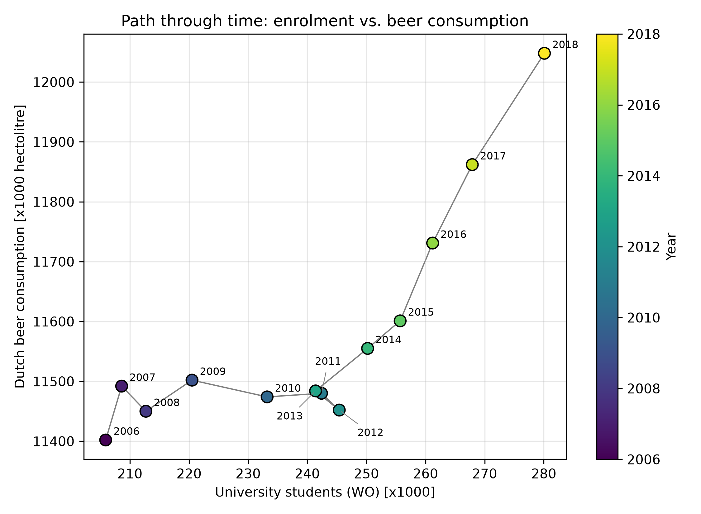

# Student_ID = 16538455

**The titles of the papers:**
1. MCC Van Dyke et al., 2019
   * The Rise of Coccidioides: Forces Against the Dust Devil Unleashed
   * Fantastic yeasts and where to find them: the hidden diversity of dimorphic fungal pathogens
2. JT Harvey, Applied Ergonomics, 2002
   * An analysis of the forces required to drag sheep over various surfaces
3. DW Ziegler et al., 2005
   * The neurocognitive effects of alcohol on adolescents and college students

## Plot from the dataset

### Description of the plot:
From 2006 to 2013 the path moves sideways, with beer consumption roughly flat while enrolment climbs. Only from 2013 onwards do both paths rise together. The overall correlation is therefore driven mainly by the last five years, which points to a shared recent trend rather than a consistent relationship.

